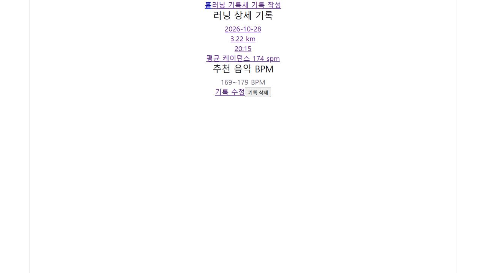

# Running Log

React를 학습하며 만든 러닝 기록 SPA입니다. 러닝 기록을 등록·조회·수정·삭제하고 평균 케이던스를 기준으로 추천 음악 BPM 범위를 확인합니다.

- 저장소: [yhana972/B1-2](https://github.com/yhana972/B1-2)
- 앱 소스 위치: 저장소의 `running-log/`
- 배포 URL: [Running Log](https://b1-2-flame.vercel.app/)
- 배포 실행 증거: [CRUD 수행 로그와 화면 캡처 3장](docs/deployment-verification.md)

## 주요 기능

- 날짜 내림차순으로 러닝 기록 목록 조회
- 카드 클릭으로 개별 기록 상세 조회
- 기록 작성·수정 및 필수값 검증, 필드별 오류 표시
- 제출 중 버튼 비활성화와 저장 실패 메시지 표시
- 확인 창을 거친 삭제, 삭제 중 상태와 실패 메시지 표시
- 평균 케이던스 기반 추천 음악 BPM 표시
- 공통 로딩·오류·빈 상태 UI 및 Not Found 페이지

추천 범위는 `평균 케이던스 - 5 ~ 평균 케이던스 + 5 BPM`입니다. 케이던스가 172 spm이면 167 ~ 177 BPM을 표시합니다. 실제 음악 API는 연동하지 않았습니다.

## 기술 스택

React 19, Vite 8, JavaScript, React Router, Supabase, ESLint, CSS

## 로컬 실행

Node.js와 npm이 필요합니다. 개발 시 확인한 환경은 Node.js 24와 npm 11입니다.

```powershell
git clone https://github.com/yhana972/B1-2.git
cd B1-2/running-log
npm.cmd ci
```

이후 명령은 모두 `package.json`이 있는 `running-log` 폴더에서 실행합니다. Windows PowerShell에서는 `npm.cmd`를 사용하면 npm 스크립트 실행 정책 문제를 피할 수 있습니다. 다른 셸에서는 `npm`을 사용해도 됩니다.

### 환경변수

`running-log/.env.local` 파일을 만들고 본인 Supabase 프로젝트의 값을 설정합니다.

```dotenv
VITE_SUPABASE_URL=your_supabase_project_url
VITE_SUPABASE_PUBLISHABLE_KEY=your_supabase_publishable_key
```

위 값은 예시입니다. 실제 환경변수 파일은 Git에 올리지 않습니다. `.gitignore`에는 `.env`와 `.env.local`이 포함되어 있습니다. 브라우저용 publishable key를 사용하며 secret key나 service role key는 넣지 않습니다. `VITE_` 환경변수는 브라우저 빌드에 포함되므로 데이터 접근 범위는 RLS 정책으로 제어합니다.

Supabase 테이블과 정책도 아래 설명에 맞게 준비한 후 실행합니다.

```powershell
npm.cmd run dev
```

터미널의 Local 주소로 접속합니다. 기본 주소는 `http://localhost:5173`이며 포트 사용 여부에 따라 달라질 수 있습니다. 종료는 `Ctrl + C`입니다. 환경변수를 변경하면 개발 서버를 다시 실행합니다.

### 검증 및 빌드

```powershell
npm.cmd run lint
npm.cmd run build
npm.cmd run preview
```

`build`는 `dist/`에 배포용 파일을 생성합니다. `preview`는 빌드 결과를 로컬에서 확인하는 서버를 실행하며, 접속 주소는 터미널에 표시됩니다.

## 페이지와 라우팅

| 경로 | 화면 |
| --- | --- |
| `/` | 홈 |
| `/runs` | 러닝 기록 목록 |
| `/runs/new` | 새 기록 작성 |
| `/runs/:id` | 기록 상세 및 BPM 추천 |
| `/runs/:id/edit` | 기록 수정 |
| 그 외 경로 | Not Found |

존재하지 않는 기록 ID는 상세·수정 화면에서 기록 없음으로 처리하고, 등록되지 않은 페이지 경로는 Not Found로 처리합니다.

## 프로젝트 구조와 역할

```text
src/
├── components/   # 재사용 UI와 공통 레이아웃
├── hooks/        # useRun.js: 단건 조회 Hook
├── lib/          # supabaseClient.js: Supabase 연결
├── pages/        # 홈, 목록, 작성, 상세, 수정, Not Found
├── App.jsx       # 라우트 구성
├── App.css
├── main.jsx      # React 진입점과 BrowserRouter
└── index.css
```

### 재사용 컴포넌트

| 컴포넌트 | 주요 props와 역할 |
| --- | --- |
| Layout | children으로 받은 페이지에 공통 헤더 적용 |
| RunCard | id와 기록 데이터로 카드 표시 및 상세 이동 |
| RunForm | initialData와 mode에 따라 작성·수정 폼 구성 |
| FormField | 입력 속성, 값, 변경 함수, 오류로 입력 UI 구성 |
| SubmitButton | isSubmitting과 label로 문구·비활성화 제어 |
| Loading | message로 로딩 안내 |
| ErrorState | message로 오류 안내, role="alert" 사용 |
| EmptyState | message로 빈 상태 안내 |

위 8개는 props에 따라 내용이나 동작이 달라집니다. Header와 Navigation은 공통 화면 구조를 담당합니다.

### 상태와 데이터 흐름

`useRun(id)`는 상세·수정 페이지에서 단건 조회를 수행하고 `{ run, loading, error }`를 반환합니다. ID가 바뀌면 조회 상태를 초기화하며 Effect cleanup으로 이전 요청의 늦은 응답을 무시합니다. 각 호출은 독립적인 state를 갖습니다.

폼은 formData로 입력값을 관리합니다. 필수값 검증을 통과하면 DB 컬럼명에 맞는 recordData를 만들어 작성 모드에서는 INSERT, 수정 모드에서는 ID 조건을 지정한 UPDATE를 실행합니다. 수정·삭제 결과가 0개면 실패로 처리합니다. 성공 후 목록 또는 상세 페이지로 이동합니다.

## Supabase 설정

테이블 이름은 `public.running_records`입니다. 새 프로젝트에서 실행하려면 아래 컬럼을 준비하고 앱이 사용하는 값과 호환되는 타입을 지정해야 합니다. 저장소에는 테이블 생성용 마이그레이션이 포함되어 있지 않습니다.

| DB 컬럼 | 용도 | 폼 필드 |
| --- | --- | --- |
| id | 기록 식별자, 기본 키 및 자동 생성값 필요 | — |
| date | 러닝 날짜 | date |
| distance | 거리(km) | distance |
| duration | 러닝 시간(분:초, 예: 45:10) | duration |
| avg_pace | 평균 페이스 | avgPace |
| avg_cadence | 평균 케이던스(spm) | avgCadence |

### 공용 학습 데모 정책

현재 로그인과 기록 소유자 구분은 없습니다. 방문자가 테스트 기록을 함께 조회·작성·수정·삭제하는 공용 데모입니다. 개인 정보나 보관이 필요한 실제 기록은 입력하지 않습니다.

RLS를 켜둔 상태에서 로그인하지 않은 브라우저 요청에 사용하는 anon 역할에 다음 접근 범위가 필요합니다.

| 작업 | 역할 | USING | WITH CHECK |
| --- | --- | --- | --- |
| SELECT | anon | true | 해당 없음 |
| INSERT | anon | 해당 없음 | true |
| UPDATE | anon | true | true |
| DELETE | anon | true | 해당 없음 |

이 정책에서는 누구나 모든 테스트 기록을 수정·삭제할 수 있습니다. 개인별 서비스로 확장하려면 인증과 소유자 기반 정책을 추가해야 합니다. 수정·삭제 결과 조회를 위해 SELECT 정책도 필요하며, 테이블의 Data API 접근 권한도 설정되어 있어야 합니다.

대시보드에서 만든 정책은 Git push에 포함되지 않습니다. 다른 Supabase 프로젝트를 사용하면 테이블과 정책을 별도로 구성해야 합니다.

## 배포

Vercel에 배포했습니다. [배포된 앱 열기](https://b1-2-flame.vercel.app/)

- 앱 폴더: running-log
- 빌드 명령: npm run build
- 결과 폴더: dist
- 배포 환경에 Supabase 환경변수 두 개 등록
- `vercel.json`의 rewrites 설정으로 페이지 요청을 `/index.html`에 연결합니다. React Router가 상세·수정 화면과 Not Found를 처리합니다.
- GitHub 연동으로 변경 사항을 push하면 연결된 브랜치의 배포가 실행됩니다. 실제 반영 여부는 Vercel 배포 완료 상태에서 확인합니다.
- 아래 동작 점검은 로컬과 배포 환경에서 각각 수행합니다.

## 동작 점검 항목

### 배포 환경 실행 증거

2026-10-28 배포 앱에서 테스트 기록을 작성·조회하고, 거리와 케이던스를 수정한 뒤 새로고침 후 유지까지 확인했습니다. 테스트 기록 삭제는 사용자가 수행했고, 이후 해당 ID의 기록 없음 화면과 목록에서 사라진 상태를 다시 조회해 확인했습니다.

- [입력값·URL·단계별 결과가 포함된 CRUD 실행 기록](docs/deployment-verification.md)
- [수정 후 새로고침 화면](docs/evidence/01-updated-record-after-reload.png)
- [삭제한 ID 재조회 화면](docs/evidence/02-deleted-record.png)
- [삭제 후 목록 화면](docs/evidence/03-list-after-delete.png)



### 점검 목록

- 빈 폼 제출 시 필드별 오류 표시
- 작성 후 목록 반영 및 카드 클릭 시 상세 이동
- 수정 폼의 기존 값 표시와 수정 후 새로고침 시 값 유지
- 케이던스 변경에 따른 추천 BPM 변경
- 삭제 취소 시 유지, 확인 시 삭제 후 목록 이동
- 존재하지 않는 기록과 잘못된 페이지 주소 처리
- 네트워크 실패 시 오류 표시 및 복구 후 재조회
- npm run lint와 npm run build 통과

## 학습 내용

컴포넌트 분리, props와 state, controlled input, 이벤트 처리, 조건부·배열 렌더링, React Router, 비동기 요청, useEffect와 cleanup, Custom Hook, Supabase CRUD를 학습했습니다. 사용자 입력과 서버 응답이 state를 변경하고 화면 렌더링으로 이어지는 흐름을 중심으로 구현했습니다.
