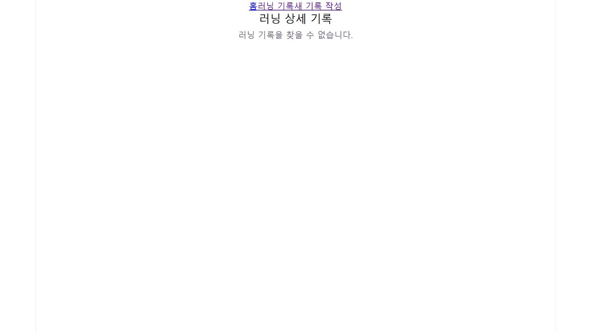
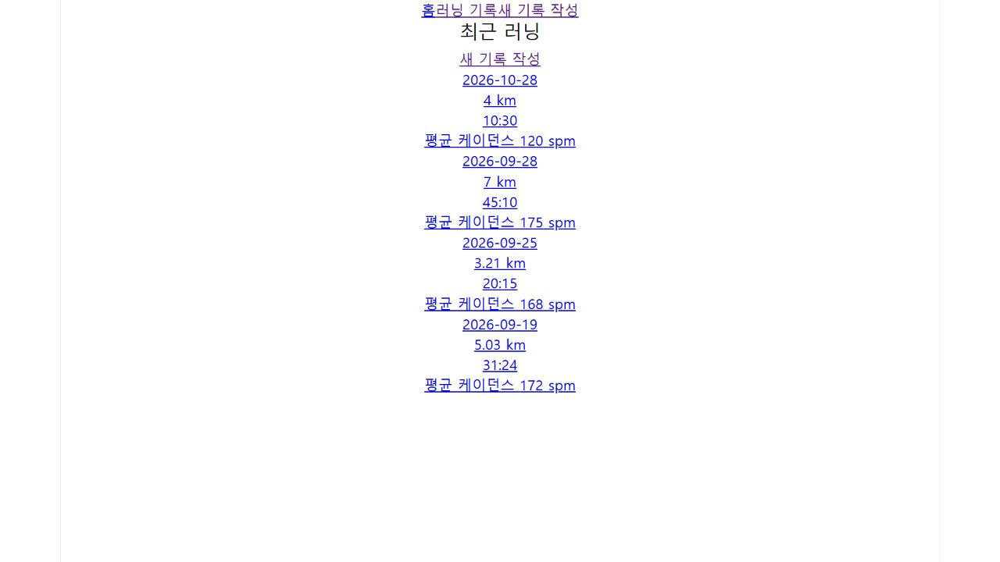

# 배포 환경 CRUD 실행 증거

## 실행 환경

- 실행일: 2026-10-28 (한국 시간)
- 배포 URL: https://b1-2-flame.vercel.app/
- 배포 확인 커밋: `4f4df67f042570e728a04fa96d39bd6520a4e39b`
- Vercel 배포 ID: `dpl_GYSmMAUiKUans59xt15cbQhB4fZ1`
- 배포 상태 확인 결과: `READY`, 대상 `production`, 소스 브랜치 `main`
- 실제 원격 Supabase를 사용하는 배포 앱의 브라우저 UI에서 수행했습니다. 로컬 개발 서버 화면이 아닙니다.

## 테스트 데이터와 수행 결과

직접 만든 테스트 기록 ID 7만 수정·삭제 대상으로 사용했습니다.

| 단계 | 수행 내용 | 실제 관찰 결과 | 확인 방식 |
| --- | --- | --- | --- |
| Create | `/runs/new`에서 날짜 2026-10-28, 거리 3.21 km, 시간 20:15, 페이스 6:18, 케이던스 172 입력 후 기록하기 | 저장 중 버튼 표시 후 `/runs` 이동, `/runs/7` 링크와 입력한 기록이 목록에 표시됨 | 브라우저 UI 및 접근성 트리 관찰 기록 |
| Read | 목록의 새 테스트 기록 클릭 | `/runs/7`에서 3.21 km, 20:15, 172 spm, 167 ~ 177 BPM 표시 | 브라우저 UI 및 접근성 트리 관찰 기록 |
| Update | `/runs/7/edit`에서 기존 값 확인 후 거리 3.22 km, 케이던스 174로 변경하고 수정하기 | `/runs/7` 이동 후 새로고침해도 3.22 km, 174 spm 유지, BPM은 169 ~ 179로 변경 | 아래 캡처 1 |
| Delete | 테스트 기록 삭제 | 사용자가 삭제 후 목록에서 사라졌다고 확인. 이후 브라우저에서 `/runs/7` 재접속 시 기록 없음, 목록에서도 ID 7 미표시 재확인 | 아래 캡처 2·3 |

삭제 확인 창에서 자동화 도구가 멈춰 최종 삭제 확인은 사용자가 직접 수행했습니다. 삭제 완료 후 원격 재조회와 캡처는 별도로 수행했습니다. 자동화 도구가 삭제 클릭부터 끝까지 통과했다는 뜻은 아닙니다.

## 작성·조회 당시 화면 관찰 로그

다음은 테스트 당시 브라우저 도구가 반환한 URL·표시 내용을 발췌해 정리한 실행 기록입니다. HTTP 응답 전문이나 별도의 자동 테스트 프레임워크 로그가 아닙니다. 생성 시점 캡처는 남기지 못했으므로 작성·최초 조회는 당시 관찰 로그로 제시합니다.

```text
[Create: 제출 전]
URL: https://b1-2-flame.vercel.app/runs/new
날짜: 2026-10-28
거리: 3.21
시간(분:초): 20:15
평균 페이스: 6:18
평균 케이던스: 172

[Create: 제출 중]
URL: https://b1-2-flame.vercel.app/runs/new
button (disabled): 저장 중...

[Create: 성공 후 목록]
URL: https://b1-2-flame.vercel.app/runs
link: 2026-10-28 3.21 km 20:15 평균 케이던스 172 spm
href: https://b1-2-flame.vercel.app/runs/7

[Read: 새 기록 상세]
URL: https://b1-2-flame.vercel.app/runs/7
2026-10-28 / 3.21 km / 20:15 / 평균 케이던스 172 spm
추천 음악 BPM: 167 ~ 177 BPM

[Update: 수정 후 새로고침]
URL: https://b1-2-flame.vercel.app/runs/7
2026-10-28 / 3.22 km / 20:15 / 평균 케이던스 174 spm
추천 음악 BPM: 169 ~ 179 BPM

[Delete: 사용자 삭제 후 별도 재조회]
URL: https://b1-2-flame.vercel.app/runs/7
러닝 기록을 찾을 수 없습니다.

[Delete: 목록 재조회]
URL: https://b1-2-flame.vercel.app/runs
표시된 기록 링크: /runs/6, /runs/3, /runs/2, /runs/1
테스트 기록 /runs/7은 표시되지 않음
```

## 캡처 1 · 수정 후 새로고침해도 값 유지

- 촬영 경로: https://b1-2-flame.vercel.app/runs/7
- 테스트 기록을 3.21 km에서 3.22 km로, 케이던스를 172에서 174로 바꾼 뒤 페이지를 새로고침한 결과입니다.
- 추천 BPM도 169 ~ 179로 바뀌었습니다.


## 캡처 2 · 삭제한 ID로 다시 접속

- 촬영 경로: https://b1-2-flame.vercel.app/runs/7
- 삭제 전 존재하던 같은 ID를 다시 원격 조회했을 때 기록 없음 화면을 표시합니다.



## 캡처 3 · 삭제 후 목록

- 촬영 경로: https://b1-2-flame.vercel.app/runs
- ID 7은 목록에서 사라졌고 기존 기록 링크는 남아 있습니다.



캡처는 테스트 시점의 실제 페이지 화면입니다. 캡처 이미지 자체에는 브라우저 주소창이 포함되지 않으므로 각 이미지 위에 촬영 URL을 기재했습니다. 테스트 기록은 삭제했기 때문에 현재 해당 주소를 열면 기록 없음이 나오는 것이 정상입니다.

## 함께 수행한 코드 검증

`npm.cmd run lint`와 `npm.cmd run build`가 수정 커밋 생성 전에 모두 성공했습니다. 이는 코드·번들 검증이며, 위 배포 UI 실행 증거와 구분합니다.
